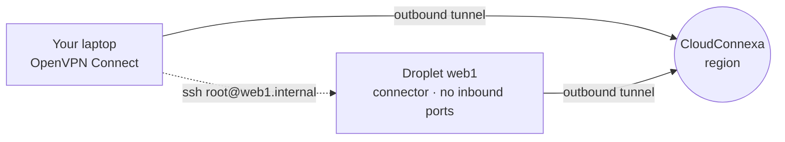

# SSH into a private DigitalOcean Droplet with CloudConnexa and ccx, with no open ports

*How to close port 22 on a Droplet and still reach it by name, using one command on your laptop and one paste on the server.*

> **About ccx.** ccx is an independent, open-source CLI ([rkalbag/openvpn-cloudconnexa-cli](https://github.com/rkalbag/openvpn-cloudconnexa-cli)). It is not made, endorsed or supported by OpenVPN Inc. It uses only the public CloudConnexa API v1. ccx is at version 0.x: the commands below are stable, but expect rough edges.

---

## The problem: port 22 on the internet

You have an Ubuntu Droplet in a DigitalOcean VPC: a staging database, an internal tool, a build box. It has a public IPv4 address because that is the easy default, and SSH is open to the world because that is how you get in.

Within minutes, `journalctl -u ssh` fills with login attempts from addresses you have never heard of. Key-only authentication keeps them out, but you are still:

- **exposing a service** to every scanner on the internet, and depending on OpenSSH having no bugs;
- **maintaining IP allowlists** in a Cloud Firewall that break whenever you work from a café, a hotel or a new office;
- **sharing access by hand**: adding keys for a new teammate, and remembering to remove them when they leave;
- or **running a bastion host**, which is one more server to patch, monitor and pay for.

What you want is simpler: **no inbound ports at all**, and a reliable way for the right people to reach the server by name.

## The idea: let the server dial out

[CloudConnexa](https://openvpn.net/cloud-vpn/) is OpenVPN's cloud-delivered ZTNA and private-networking service. Users connect with the OpenVPN Connect app. Servers and networks join through **connectors**: a small OpenVPN client on the server that makes an **outbound** connection to the nearest CloudConnexa region.

Because the connector dials out, the Droplet needs **no inbound firewall rules**. Your laptop and the Droplet both connect out to CloudConnexa, which routes traffic between them according to your access policies.



In CloudConnexa terms, the Droplet becomes a **Host** with:
- a **connector** (the tunnel from the Droplet);
- a **domain** (`web1.internal`) that CloudConnexa DNS resolves for connected users;
- an **IP service** that says which traffic may reach it (here, SSH only).

### Where ccx fits

You can set all of this up in the CloudConnexa Admin Portal. It takes several pages of forms, then a copy-and-paste of an install script and an interactive token prompt on the server. That is fine once, and tedious the tenth time.

**ccx** turns it into two steps:

| Where | What you run |
|---|---|
| Laptop | `ccx add web1 ssh` |
| Server | paste the one line ccx prints |

ccx creates the Host, connector and IP service through the CloudConnexa API, and generates a one-time enrolment token. The server only ever sees that token. Your API secret never leaves your laptop's keychain, and if any step fails, ccx deletes what it created so you are not left with an orphaned, seat-consuming connector.

---

## What you need

- **A CloudConnexa account on the Essential plan or higher**, or the 14-day trial. The free Starter plan has no API access.
- **A CloudConnexa user account for yourself.** The account owner already has one; anyone else needs an invitation from an admin. You'll connect your laptop with it in Step 2.
- **A DigitalOcean account**, plus `doctl` if you want the command-line route. Every step also works in the DigitalOcean control panel.
- **An SSH key** added to your DigitalOcean account.
- **One free CloudConnexa seat.** A connector uses a seat from the moment it is created.

## The scenario

| | |
|---|---|
| Cloud | DigitalOcean, region `nyc3` |
| Network | VPC `private-net`, `10.10.10.0/24` |
| Server | Ubuntu 24.04 Droplet `web1` |
| Goal | `ssh root@web1.internal` from the laptop, with **no inbound rules** on the Droplet |

We will briefly allow SSH from your own IP so you can paste the enrolment line, then remove that rule for good. (To skip even that, see [Never opening port 22](#variant-never-opening-port-22).)

---

## Step 1: Create a CloudConnexa API credential (once)

In the CloudConnexa Admin Portal (`https://<your-cloud-id>.openvpn.com`):

1. Go to **API & Logs → API → Create Credentials**.
2. Give it a name such as `ccx-laptop` and a lifetime. One year is sensible for a personal laptop.
3. Grant only these permissions:
   - **Host – Modify**
   - **Connector Profile – Modify**
   - **Region – Read Only**
   - **Settings – Read Only**
4. Save, and copy the **client ID** and **client secret**. The secret is shown once.
5. The page now shows **Enable API to activate authentication credentials**. CloudConnexa switches it on automatically when you create your first credential; just check that it's on.

> Your **Cloud ID** is the first part of your portal address: for `https://acme.openvpn.com` it is `acme`.

## Step 2: Connect your laptop to CloudConnexa (once)

Step 1 gave the **ccx CLI** access to the CloudConnexa **API**, so it can create hosts and tokens. It doesn't put your **laptop** on the CloudConnexa network. That is OpenVPN Connect's job, and you need it before you can reach any private server:

1. Install **OpenVPN Connect** from [openvpn.net/client](https://openvpn.net/client/) (macOS, Windows, Linux).
2. Open it and choose **Import Profile → URL**. Enter your CloudConnexa address, `https://<your-cloud-id>.openvpn.com`.
3. Sign in with your CloudConnexa **user** credentials (or your company SSO, if configured). This is your own login, not the API credential from Step 1.
4. OpenVPN Connect downloads your profile. Turn the connection **on**.

Your laptop is now part of your CloudConnexa network and uses its DNS, which is what will make names like `web1.internal` resolve in Step 9.

> `ccx login` doesn't do this, and ccx never sees your user credentials. Each user can connect a limited number of devices (3 per user on Essential), so this laptop uses one of yours.

You can do Steps 3–8 without the VPN connected. Only Step 9 (SSH by name) needs it.

## Step 3: Install ccx and log in (once)

ccx is a single Go binary. Until release binaries are published, install it with Go 1.26 or later:

```bash
go install github.com/rkalbag/openvpn-cloudconnexa-cli/cmd/ccx@latest
ccx version
```

Then log in:

```bash
ccx login
```

ccx asks for:
- your **Cloud ID** and **client ID**;
- your **client secret**, typed hidden and saved only in the OS keychain;
- the **credential lifetime** you chose, so it can warn you before the credential expires;
- a **domain suffix** for new servers (default `internal`, giving names like `web1.internal`);
- a **default region**. Pick the CloudConnexa region closest to your Droplet; for `nyc3`, that is a US East region.

```text
Checking credentials...
...
Logged in to acme.api.openvpn.com
  client ID:      ccx-laptop.acme
  default region: <region-id> (New York, United States)
  domain suffix:  .internal
  credential:     1 year, expires around 26 Oct 2027 (estimated from today)
  secret:         stored in the OS keychain
  config:         /Users/you/Library/Application Support/ccx/config.toml
Next: ccx add <name>
```

If ccx warns that **topology is CUSTOM**, your network uses access groups instead of Full Mesh. New hosts will be unreachable until an access group allows your user group to reach them. Add that in the portal under **Access → Access Groups** after Step 5.

Check that everything is in order:

```bash
ccx doctor
```

## Step 4: Create the VPC and Droplet

**Control panel:** go to **Networking → VPC → Create VPC** (`private-net` in `nyc3`). Then go to **Create → Droplets**: Ubuntu 24.04, region `nyc3`, VPC `private-net`, your SSH key, hostname `web1`.

**Or with doctl:**

```bash
doctl compute vpc create --name private-net --region nyc3 --ip-range 10.10.10.0/24

VPC_ID=$(doctl compute vpc list --format ID,Name --no-header | awk '$2=="private-net"{print $1}')
SSH_KEY=$(doctl compute ssh-key list --format FingerPrint --no-header | head -n1)

doctl compute droplet create web1 \
  --region nyc3 --image ubuntu-24-04-x64 --size s-1vcpu-1gb \
  --vpc-uuid "$VPC_ID" --ssh-keys "$SSH_KEY" --wait
```

### Lock the Droplet down with a Cloud Firewall

Create a firewall that allows **all outbound** traffic, which the connector needs, and **inbound SSH from your current IP only**, for the next few minutes:

```bash
MY_IP=$(curl -fsS https://ifconfig.me)
DROPLET_ID=$(doctl compute droplet list --format ID,Name --no-header | awk '$2=="web1"{print $1}')

doctl compute firewall create --name web1-fw \
  --droplet-ids "$DROPLET_ID" \
  --inbound-rules "protocol:tcp,ports:22,address:$MY_IP/32" \
  --outbound-rules "protocol:tcp,ports:all,address:0.0.0.0/0,address:::/0 protocol:udp,ports:all,address:0.0.0.0/0,address:::/0 protocol:icmp,address:0.0.0.0/0,address:::/0"
```

## Step 5: Add the server with ccx

On your laptop:

```bash
ccx add web1 ssh
```

The `ssh` argument creates an IP service that allows **only SSH (TCP 22)** to the host. Leave it out to allow all traffic, or list more, e.g. `ccx add web1 ssh https tcp:5432`.

```text
Run this on web1 (a new token invalidates this one):
  curl -fsSL https://raw.githubusercontent.com/rkalbag/openvpn-cloudconnexa-cli/main/scripts/install.sh | sudo bash -s -- <TOKEN>
Once online: `ccx status web1`, then `ssh user@web1.internal`
```

Behind that one command, ccx:
1. checked that no host named `web1` or domain `web1.internal` already exists;
2. created the Host `web1` with domain `web1.internal`, marked `[ccx]` in its description;
3. created its connector `web1-connector` in your default region;
4. created the IP service `web1-services` allowing SSH;
5. generated a **one-time connector token**, printed only here.

> Treat that line like a password until it has been used. Running `ccx token web1` generates a new one and invalidates the old.

## Step 6: Paste the line on the Droplet

SSH in over the public IP **one last time**:

```bash
ssh root@<droplet-public-ip>
```

Paste the line from Step 5. It:
- adds OpenVPN's package repository;
- installs `python3-openvpn-connector-setup`;
- enrols the connector with the token;
- starts it as a systemd service, so it survives reboots.

```text
==> Adding the OpenVPN apt repository (noble)
==> Installing python3-openvpn-connector-setup
==> Enrolling this host with CloudConnexa
==> Done. Check from your laptop: ccx status <name> --wait 2m
```

> **Just booted?** Ubuntu installs updates on first boot and holds the package lock meanwhile. The script waits for it (up to 5 minutes) and may print *apt is busy… retrying*, which is fine. If it says the token was already used, run `ccx token web1` for a fresh line.

Log out of the Droplet.

## Step 7: Wait for it to come online

Back on your laptop:

```bash
ccx status web1 --wait 2m
```

```text
Waiting up to 2m0s for web1 to come online...
web1: ONLINE
  domain:      web1.internal
  tunnel IPv4: 100.96.1.10
  region:      <region-id>
```

```bash
ccx ls
```

```text
NAME  DOMAIN         STATUS  TUNNEL IPV4  REGION
web1  web1.internal  ONLINE  100.96.1.10  <region-id>
```

## Step 8: Close port 22 for good

Remove the temporary inbound rule. The firewall now has **no inbound rules at all**:

```bash
FW_ID=$(doctl compute firewall list --format ID,Name --no-header | awk '$2=="web1-fw"{print $1}')
doctl compute firewall remove-rules "$FW_ID" \
  --inbound-rules "protocol:tcp,ports:22,address:$MY_IP/32"
```

Prove that the public route is gone:

```bash
ssh -o ConnectTimeout=5 root@<droplet-public-ip>
# ssh: connect to host ... port 22: Operation timed out
```

## Step 9: SSH by name

Make sure OpenVPN Connect shows **Connected** (Step 2), then:

```bash
ssh root@web1.internal
```

Or let ccx handle it:

```bash
ccx ssh root@web1
```

`ccx ssh` looks up the host's domain. If the name does not resolve (for example, your DNS has not picked up CloudConnexa's yet), it falls back to the connector's tunnel IP and tells you so.

That's it. The Droplet has no inbound ports, and anyone you grant access in CloudConnexa can reach it by name from anywhere.

---

## Day-two operations

| Task | Command |
|---|---|
| List your servers | `ccx ls` (`--all` includes hosts made in the portal; `--json` for scripts) |
| Rebuilt the Droplet? Re-enrol | `ccx token web1`, then paste the new line (add `--force` at the end if the server was enrolled before) |
| Pause it and free the seat | `ccx sleep web1` · resume with `ccx wake web1` |
| Remove it completely | `ccx rm web1` (asks first; `--yes` to skip) |
| Check your setup and credential expiry | `ccx doctor` |
| Sign out of this laptop | `ccx logout` |

**Giving a teammate access:** they don't need ccx. Invite them as a CloudConnexa user, have them connect with OpenVPN Connect, and they can run `ssh web1.internal` (with their own key on the server). Under Full Mesh topology every user can reach every host. Use access groups to narrow that down.

## Clean up

```bash
ccx rm web1 --yes                 # deletes the host and connector, frees the seat
doctl compute droplet delete web1 --force
doctl compute firewall delete "$FW_ID" --force
doctl compute vpc delete "$VPC_ID" --force
```

---

## Variant: never opening port 22

If the Droplet must never accept inbound SSH, even briefly, enrol it at creation time with **user data**:

1. Run `ccx add web1 ssh` first and copy the printed line.
2. Create the Droplet with the firewall from Step 4, but **without** the inbound rule.
3. Pass the line as user data, so cloud-init runs it on first boot:

```bash
cat > web1-user-data.sh <<'EOF'
#!/bin/bash
# The install script waits for first-boot package updates to finish.
PASTE-THE-LINE-FROM-CCX-ADD-HERE
EOF

doctl compute droplet create web1 \
  --region nyc3 --image ubuntu-24-04-x64 --size s-1vcpu-1gb \
  --vpc-uuid "$VPC_ID" --ssh-keys "$SSH_KEY" \
  --user-data-file web1-user-data.sh --wait
```

Then continue at Step 7.

Two trade-offs:
- **The token stays in the Droplet's metadata.** It is single-use and worthless once the connector has enrolled, but delete `web1-user-data.sh` from your laptop afterwards.
- **If enrolment fails, you have no way in.** Use the Droplet's **Recovery Console** in the control panel, and check `/var/log/cloud-init-output.log`.

## Troubleshooting

| Symptom | Likely cause and fix |
|---|---|
| `credentials rejected` at login | Wrong Cloud ID, client ID or secret, or the credential has expired. Create a new one and run `ccx login` again. |
| `access denied: check the plan…` | The account is on Starter, which has no API, or the credential is missing one of the four permissions. |
| `topology is CUSTOM` warning | Add an access group that lets your users reach `web1`. |
| `ccx status` stays OFFLINE | On the Droplet, check that outbound traffic is allowed, then run `journalctl -u 'openvpn3*'`. If the token was used or replaced, run `ccx token web1` and paste again. |
| `web1.internal` does not resolve | Check OpenVPN Connect is connected. Meanwhile, `ccx ssh root@web1` uses the tunnel IP. |
| `ccx add` reports an error | Nothing to clean up: ccx deletes the host it created in that run. If it says *ROLLBACK FAILED*, run the `ccx rm … --yes` command it prints. |

## How ccx keeps things safe

- **The API secret stays on your laptop**, in macOS Keychain, Windows Credential Manager or the Linux Secret Service. It is never written to config files, logs or output.
- **Servers only get a one-time connector token.** With `ccx add --push user@host`, the token is sent over SSH's stdin, never on a command line.
- **ccx only touches what it created.** Hosts are tagged `[ccx]`, and `ccx token`, `sleep`, `wake` and `rm` refuse other hosts unless you pass `--force`.
- **No orphaned seats.** If any step after host creation fails, ccx deletes the host. If the API errors while creating it, ccx checks whether the host was created anyway and removes it.

---

*Found a bug or want another distro? Open an issue at [github.com/rkalbag/openvpn-cloudconnexa-cli](https://github.com/rkalbag/openvpn-cloudconnexa-cli/issues).*
